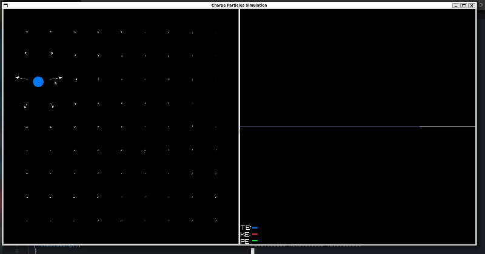
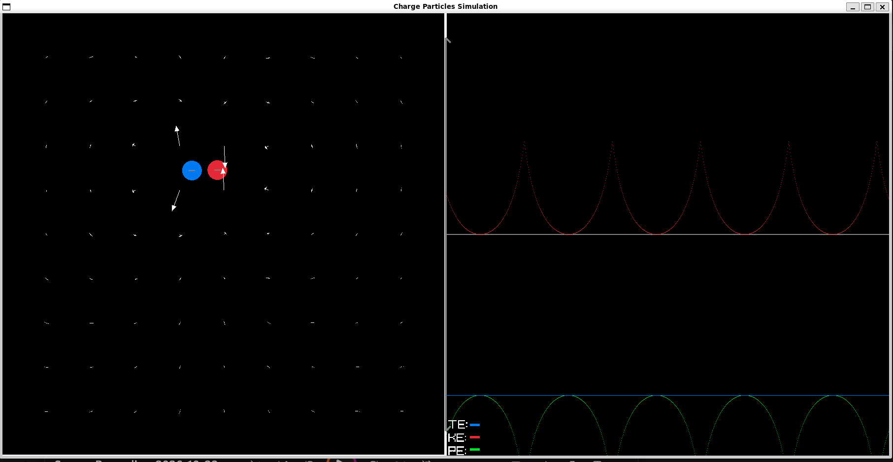

# Charge Particle Simulator

A small **2D electrostatic particle simulator** written in C using [raylib](https://www.raylib.com/). Add positive and negative charges, launch them by dragging the mouse, watch their motion, and inspect the electric-field arrows and kinetic, potential, and total energy graphs.

> **Status:** Personal learning project / work in progress. The simulation is useful for experimenting with particle motion and numerical physics, but the collision handling and energy conservation are still being refined. Treat the results as a visual approximation rather than a validated physics engine.

## Demo

## Features

- Add positive and negative particles interactively.
- Launch particles by dragging from their spawn point to set an initial velocity.
- Calculate pairwise electrostatic forces using Coulomb-like interactions.
- Display approximate electric-field arrows across the simulation area.
- Show particle trails to make trajectories easier to follow.
- Plot potential energy (PE), kinetic energy (KE), and total energy (TE) over recent frames.
- Include wall bounces and particle-particle collision handling.
- Stop the simulation by pressing Space Bar.

Edit:
added options to toggle EF arrows 
added 2 more panels momentum.x vs pos.x graph and raw data ,u can switch between them 
## Controls

|Action|Control|
|---|---|
|Add a positive charge|Left-click, drag, then release|
|Add a negative charge|Right-click, drag, then release|
|Set initial velocity|Drag direction and distance before releasing|
|Pause/resume|Space bar|
|Toggle EF arrow|E|
|Toggle side panels|P|
|Change focused charge|Press F ,while mouse is on that charge|
|Close the simulation|Close the window or press `Esc`|

A particle is only added when its starting position is inside the simulation area and does not overlap an existing particle. The initial velocity is based on the mouse displacement during the drag, so longer drags produce larger initial speeds.

## Current limitations

- **Collision response is experimental.** Particles use circular overlap checks and a collision response intended for equal masses. The overlap correction can change electrostatic potential energy abruptly.
- **Energy correction is not guaranteed to work.** The code attempts to compensate for potential-energy changes during overlap correction, but some cases have no valid real-valued correction. Total energy may therefore jump during collisions.
- **Numerical accuracy depends on the time step.** The simulation currently advances by a fixed 1/60-second step per rendered frame. Close encounters and fast particles may need a smaller time step or substeps for better stability.
- **The model is simplified.** It does not include electromagnetic radiation, relativistic effects, charge distributions, or other real-world effects.
- **Units are arbitrary.** The constants and screen coordinates are chosen for a visible interactive demonstration, not a calibrated physical experiment.

EDIT: improved collision response by adding event based collision detection ,now i dont fix overlap by moving particles

#### Key things I learnt
* Velocity Verlet — updating position using the current velocity and acceleration, recalculating acceleration, then updating velocity using the old and new accelerations.
